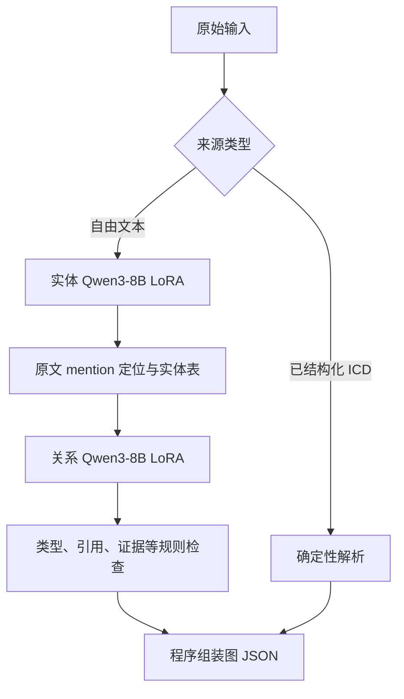

**当前仓库训练工作梳理（2026-10-26）**

结论：项目已经从“Gemini 生成 CoT/KG → LLaMA-Factory 微调一个 Qwen3-8B → 直接生成整张 JSON 图”，演变为“清理教师银标 → 分别训练实体和关系两个 Qwen3-8B LoRA → 程序验证并组装图”。最新主线使用 DeepSeek 银标，而不是简单继续使用旧 Gemini 858 条数据。已经有完整训练和验证记录；当前保留组合的自由文本关系 F1 是 47.89%，仍缺独立人工金标盲测。

阅读范围是本地代码、配置、数据分布及截至 2026-10-19 的实验报告。本次没有重新训练、调用抽取 API 或运行 GPU 推理；下列性能数值来自仓库保存的聚合报告。本副本未找到当前 semantic adapters 的权重以及用于这些实验的私有完整数据/预测，不能把本次阅读说成独立复现了其性能。

**1. 和你上一次训练的区别**

| 维度 | 你熟悉的早期路线 | 当前推荐路线 |
|---|---|---|
| 入口 | `src/kg_lora/`、`scripts/01…04`、LF YAML | `agent/run_semantic_pipeline.py`、`agent/semantic/` |
| 教师数据 | Gemini；旧 614/635，后来完整 858 条 | DeepSeek `medical-kg-extraction-v3.1.1` 教师银标，源记录 1,345 条 |
| 训练框架 | LLaMA-Factory；旧配置有 4-bit QLoRA | 自写训练入口，使用 Transformers Trainer + PEFT；当前代码加载 bf16 底座训练 LoRA |
| 模型 | 一个 Qwen3-8B adapter 学整张图 | 同一 Qwen3-8B 底座，实体/关系分开训练两个 adapters |
| 模型输出 | CoT + 大段实体、属性、关系 JSON | 可读的语义文本记录；没有长 CoT；程序生成 ID/JSON |
| 优化重点 | 跑通生成、转换、SFT、base/adapter 对比 | 数据修复、实体定位、证据、训练推理一致性、短窗监督、关系语义、负例/未知标注、正式图评分 |
| 评测 | 早期以实体/关系数量、JSON 合法率等统计为主 | 按实体和关系集合算 P/R/F1，区分 live/oracle、规则前后、自由文本/结构化输入 |

根目录 README 和 CLAUDE.md 的大量内容仍描述早期工作。判断当前路线应优先看 [agent/README.md](../../agent/README.md)、[semantic 协议](../../agent/semantic/protocol.py)、[最终 SFT 汇总](../../docs/audits/20261019/final-experiment-summary.json) 和 [DPO24 最终结果](../../docs/audits/20261019-round3/DPO24-RESULT.zh.md)。

**2. 当前模型具体怎么抽取**

实体目标每行是 `类型<TAB>原文 mention<TAB>完整规范名`；关系目标每行是 `源类型<TAB>源名称<TAB>完整关系标签<TAB>目标类型<TAB>目标名称<TAB>原文证据`。关系阶段还读取原文和已得到的实体表。模型负责识别与判断，程序负责定位、编号、去重和格式。它仍是自回归语言模型，没有在当前 semantic 路线上使用关系分类头。

当前 graph assembler 公开输出实体的 `id/label/name` 和关系的 `source/target/relation/evidence`。旧版的丰富 `properties`、CoT 并非这轮训练输出及主评分的完整对象；因此当前 F1 不代表旧 schema 所有属性都已抽取和评测。

历史上试过关系分类头、逐候选对生成、数字选择协议，以及四字段关系标签/引用协议。现推荐的 `semantic-text-v1` 已采用语义名称和完整标签；旧模型、旧 prompt 和新协议不通用。`agent/generative/README.md` 也包含历史计划，不应把其中计划的 GRPO、全部消融或多 seed 实验一概写成当前完成成果。

证据：[协议字段、规则和实际 JSON 组装](../../agent/semantic/protocol.py)、[Trainer/PEFT 实现](../../agent/semantic/train.py)、[统一非 thinking 模板](../../agent/generative/chat.py)。

**3. 数据方面做了什么**

旧 `data/schema_v2/` 路线包含对 Gemini 858 条数据的 schema 迁移、文本损坏修复、ICD 核对、证据修复和 LF 数据转换。当前 `agent/data_repair/` 处理另一套 DeepSeek 教师银标，不应把两套版本的数量、关系重写或成绩混用。[数据修复说明](../../agent/data_repair/README.md)明确记录了这条边界。

当前 1,345 条源记录分为 739 条自由文本、606 条结构化 ICD；冻结来源组 train/tune 为 545/61 组，对应：

| 来源 | Train 记录 | Tune 记录 | 用途 |
|---|---:|---:|---|
| 自由文本 | 670 | 69 | 模型训练和模型质量评测 |
| 结构化 ICD | 545 | 61 | 单列确定性解析路线 |
| 合计 | 1,215 | 130 | 不能当成 1,345 条全部用于 LoRA 训练 |

实际实体监督来自 668 条自由文本记录，关系监督来自 542 条。短窗修复后分别派生 1,361 行实体训练、1,000 行关系训练。这些是切窗训练行，不是新增独立文档；6,484 个实体监督项和 5,551 个关系/证据监督项也不能当成全局去重医学概念数量。

主要修复包括原文中的 `nan/null` 类损坏、精确 mention/span 定位、多关系保留、证据歧义分流、来源组隔离，以及重叠窗口里完整可见却遗漏监督的问题。未标注候选保持 UNKNOWN，不能自动标成“无关系”。银标经机械修复仍然不是医学专家 gold。

仓库还记录并处理了旧训练文件混入内部 tune 的问题：旧实体文件含 69 条 tune 记录派生的 119 行，旧关系文件含 49 条 tune 记录派生的 89 行。10 月 19 日新发布版记录为重新按冻结来源组编译，未复用这些旧文件；本次未拿到私有数据逐条重新检查。

当前 ontology 是 15 类实体、78 个不同关系标签，共 82 个“源实体类型—关系标签”条目。这与 `schemas/current.json` 当前指向的 `3.0.0-draft.2` 筛选 schema 不是同一份运行契约。更关键的是，实际实体训练只覆盖 9 类，tune 只覆盖 3 类；不能把“schema 定义了 15 类”写成“15 类都有充分训练与测试”。

证据：[数据发布清单](../../docs/audits/20261019/semantic-data-release.json)、[最终监督规模](../../docs/audits/20261019/final-experiment-summary.json)、[实际标签分布](../../docs/audits/20261019/label-distribution.json)、[当前运行 ontology](../../agent/kg_agent/ontology.json)。

**4. 训练方面实际完成了哪些实验**

10 月 19 日第一轮记录了 7 次完整两轮 SFT（3 次实体、4 次关系）及 8 组完整 130 条评测，后续又试过实体三轮、长条件重采样、标签加权续训和三版 DPO。下表列最有解释力的对照，均不是和旧 Gemini/LF 模型的同条件比较。

| 实验 | 自由文本关系 F1 | 解释 |
|---|---:|---|
| 当天 semantic 完整来源起点 | 25.29% | 新协议下起点，不能替代旧 LF 基线 |
| 固定实体及推理 batch：完整来源关系 → 短窗完整监督 | 26.62% → 35.65% | 有验证收益，但同时改变长度、监督曝光和更新数 |
| 同数据/曝光：来源排序 → 语义名称排序 | 35.65% → 36.18% | 小幅验证收益，不证明稳定性提升 |
| 固定关系：实体 LR 5e-5 → 1e-4 | 36.29% → 40.44% | 上游实体改善带来的流水线收益 |
| 固定新实体：关系 LR 5e-5 → 1e-4 | 40.44% → 47.89% | 本轮较清晰的关系参数收益 |
| 关系标签 token 权重 4，另续训 1 epoch | 47.99% | 相对 47.89% 仅 +0.10 个百分点；缺等量不加权续训对照，未替换 |
| DPO208 / DPO52 / DPO24 | 46.75% / 46.58% / 46.93% | 都没超过原 SFT，未采用 |

保留组合的实体和关系 LoRA 都是 rank16、alpha32、dropout0.05、LR1e-4、2 epochs、batch1/accum8。训练使用 2,400 字符窗口、400 字符重叠；关系采用语义名称排序。关系模型 250 次参数更新，实体 342 次；训练输入上限 8,192 tokens。后续标签加权续训用了不同 LR/epoch，不能把其效果单独归给标签权重。

DPO 是标准 sigmoid DPO：从选定关系 SFT 初始化 policy 和冻结 reference，比较完整 chosen/rejected 回答。DPO24 使用 24 对经过复核的银标偏好，包含 13 个肯定、8 个否定、3 个层级方向对比，每对只改变一条标签或方向；不是提出了新的 DPO 算法，也不是新增 24 篇独立 SFT 文档。DeepSeek Flash 参与过候选复核。另一个扩增尝试的候选没有通过准入，实际新增 SFT 数据为零。

证据：[训练参数及完整结果](../../docs/audits/20261019/final-experiment-summary.json)、[关系改进与 DPO 专项说明](../../docs/audits/20261019-round3/RELATION-DPO-REPORT.zh.md)、[DPO24 最终收尾](../../docs/audits/20261019-round3/DPO24-RESULT.zh.md)。早期报告中的“DPO24 评测中”已被最终报告补充，不能停在旧状态。

**5. 当前成绩究竟代表什么**

| 保留 SFT 组合；69 条自由文本 | TP | FP | FN | Precision | Recall | F1 |
|---|---:|---:|---:|---:|---:|---:|
| 实体 | 401 | 117 | 247 | 77.41% | 61.88% | 68.78% |
| 实际实体 → 关系，全流程 | 238 | 183 | 335 | 56.53% | 41.54% | 47.89% |
| 给定正确实体的关系诊断 | 422 | 125 | 151 | 77.15% | 73.65% | 75.36% |

分母固定为 648 个实体、573 条关系。关系按“源类型/规范名、关系标签、目标类型/规范名、方向”做去重集合比较；仅统一 Unicode、大小写、空白，不给自由同义改写加分。证据不参与关系身份，另有证据指标和规则检查；属性未包含在上述成绩中。

这些是反复用于模型选择的 tune 银标匹配分数。它们能说明当前对照实验的表现，不能充当独立盲测或临床正确率。加上 61 条结构化记录后，保留 SFT 组合的关系 F1 为 51.53%；这一混合分数不能称为纯自由文本模型能力。程序能生成合法 JSON 也不等于关系正确。

**6. 现在最明显的瓶颈**

- **实体漏召回。** 335 个关系 FN 中，262 个缺至少一个实体端点。实际实体表仅覆盖 311/573 条 gold 关系的两端；在固定此实体表且零 FP 的理想条件下，关系 F1 上限约 70.36%。这不是模型实测成绩，也不是换实体模型后的理论上限。
- **长诊断条件与精确名称。** 超过 160 字符的完整诊断条件仅精确命中 3/53；很多原文完整可见，不能都归为切窗截断。需进一步区分真漏检和边界/规范名表达差异。
- **关系语义及连接对象。** 核心/伴随症状混淆、`rules_out` 与 `differentiates_from` 混淆、症状该连疾病还是诊断条件，都是格式检查无法解决的问题。
- **训练/推理分布不同。** 1,000 个关系训练窗口全部有正目标，实体表至少 2 个节点，使用完整来源实体；推理时会漏实体、有噪声、甚至单实体。尚缺经过审定的空关系目标与实际预测实体表监督，不能把所有漏标当负例补上。
- **银标与评测覆盖。** 当前 tune 实体只有 Disease 275、Symptom 290、Diagnostic Criterion 83。没有用药或治疗实体 gold；成绩不能支持治疗文献抽取能力的结论。模型 FP 也仅表示不匹配银标，未逐条证明是医学幻觉。

证据：[最终错误诊断](../../docs/audits/20261019/final-error-diagnostic.json)、[关系监督覆盖](../../docs/audits/20261019-round3/relation-training-coverage.json)、[问题和具体例子](../../docs/audits/20261019-round3/RELATION-DPO-REPORT.zh.md)、[tune 标签分布](../../docs/audits/20261019/label-distribution.json)。

你可以把同学这段工作的贡献概括为：**把一次性整图 SFT 改成可定位问题的两阶段抽取系统，做了银标清洗与来源隔离，完成短窗监督、学习率和偏好优化实验，建立了更严格的评测与错误分析。当前有验证集上的实测改进，但缺覆盖实际应用的独立人工金标 benchmark。**
